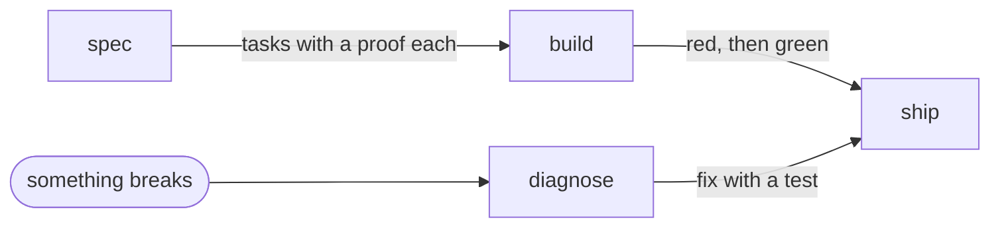

<p align="center">
  <picture>
    <source media="(prefers-color-scheme: dark)" srcset="assets/logo-dark.svg">
    
  </picture>
</p>

# exo

<p align="center">
  <strong>An exoskeleton for AI engineering. A plugin for Claude Code.</strong>
</p>

<p align="center">
  <a href="https://github.com/blauwtje/exo/actions/workflows/quality.yml"></a>
</p>

Claude says it is done. The test never ran, the bug fix was a guess, and the pull request went out without a check. exo is a small set of skills built on one rule:

> **Nothing counts as done until you have seen it run.**

Each skill turns that rule into a habit at one point of the work: a plan where every task carries a command that fails today, a build that watches each one go from red to green, a bug hunt that starts with a reproduction, and a push that waits for your yes.

## Install

It needs git and `bash` on `PATH`.

Inside Claude Code, run these, then restart it:

```text
/plugin marketplace add blauwtje/exo
/plugin install exo@blauwtje
```

To check, type `/exo:` in a new session. If it lists exo's skills, exo is loaded.

<details>
<summary>Update or uninstall</summary>

Update with `claude plugin update exo@blauwtje` in a terminal, then restart. Uninstall with `/plugin uninstall exo@blauwtje`.

</details>

## How it works



You do not call the skills by name. Say what you want and Claude starts the one that fits.

## Skills

| You say | Skill | What it does |
|---|---|---|
| "plan how we add CSV export" | [spec](skills/spec/SKILL.md) | Turns a request into a brief: the user's decisions, then tasks that each carry a proof command. |
| "run the plan" | [build](skills/build/SKILL.md) | Builds a planned change task by task, each proof seen failing then passing, and reviews it once. |
| "the export writes duplicate rows, find out why" | [diagnose](skills/diagnose/SKILL.md) | Finds a bug's proven root cause, then fixes it with a test seen red first. |
| "ship it" or "open a PR" | [ship](skills/ship/SKILL.md) | Pushes, opens, watches and merges pull requests, fixing failing checks, conflicts and review comments. |
| "save this session", later "continue from the handoff" | [save](skills/save/SKILL.md) | Writes a handoff for unfinished work and resumes it in a fresh session. |
| "do not leave `console.log` in `src/`, remember this" | [learn](skills/learn/SKILL.md) | Turns a repeated correction into a failing check or one short lesson note. |
| "search for what people say about X" | [search](skills/search/SKILL.md) | Writes a cited research report from pages read in the run. |
| a video link and a question | [watch](skills/watch/SKILL.md) | Answers from a video's captions or speech transcript, citing the moment of each fact. |
| "give me ideas for X" | [ideas](skills/ideas/SKILL.md) | Generates ideas on any question and judges them apart against what already exists. |

A typo or a one-line edit needs no skill.

The helper agents [builder](agents/builder.md) and [researcher](agents/researcher.md) do work the skills send them, and the [adhd](output-styles/adhd.md) output style keeps replies short.

## Philosophy

Each skill and agent first reads [BASE.md](BASE.md), one page of shared rules. Each skill is one Markdown file of at most 500 lines, with longer layouts in a `references/` folder beside it. Code rules are in [CODE.md](CODE.md).

## Contributing

See [CONTRIBUTING.md](CONTRIBUTING.md) for working on exo and [CHANGELOG.md](CHANGELOG.md) for what changed in each release.

## License

[MIT](LICENSE) licensed.
